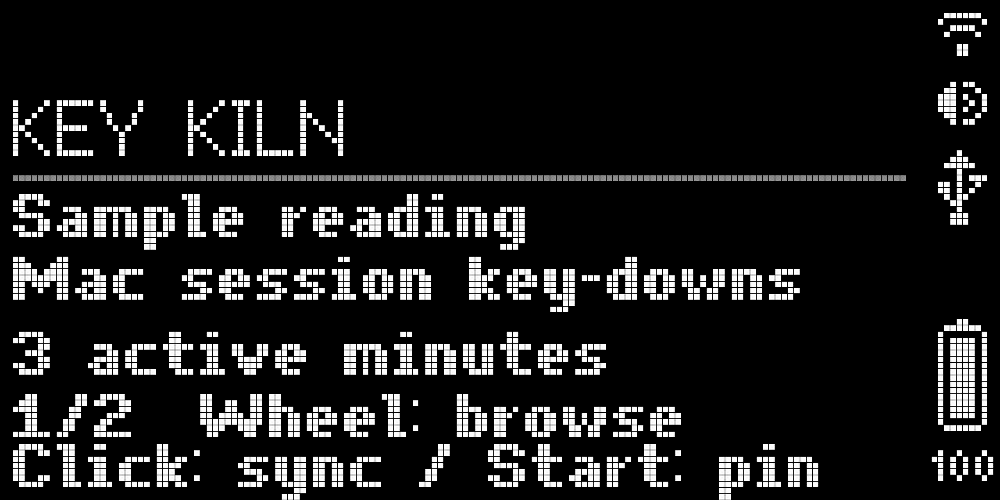

# Key Kiln

Separate daily physical key presses from characters entered in an opt-in writing pad.

A keyboard shortcut counts as keyboard activity, while pasting a paragraph can add a lot of writing with a single shortcut. Key Kiln keeps these two counts on separate pages.

## Screen transitions

Switch between keystrokes and entered text. Each figure keeps its place below the label.


<details>

<summary>Watch the rear display</summary>



</details>

## Compare pressing keys with entering text

1. Start the system counter and, for a writing session, the separate writing pad. Configure both output files.
2. Look at **KEY PRESSES** for the Mac session’s aggregate key-down count. In the fixture the total is 240.
3. Turn the wheel to **CHARACTERS**. The writing pad has recorded 150 inserted characters in the same daily example.


## Read the counters at the end of a session

1. Turn back to **KEY PRESSES**. Read active minutes on the rear to give the daily total some context.
2. Text entered elsewhere does not add characters to the writing pad. Pasting into the pad does. Deleting a passage leaves the cumulative insertion count intact.
3. If one page reads **No data**, check the path and collector for that particular count.


## Example from the emulator

The two sample totals cover different types of work. Subtracting the 150 characters from 240 keys would not tell you how many shortcuts were used. Only aggregate counts and active minutes are needed by the companion. The two collectors’ daily file formats supplied the sample totals.

## Set up the source

Run swift companion/keys.swift ~/key-counts.json for system-wide aggregate key-down counts. It reads the WindowServer event counter only. For characters, run python3 companion/writer.py ~/character-counts.json using a Python installation with Tk. Only text inserted in that visible writer counts, including paste. Deletion leaves the cumulative typed count intact. The writer stores counts and minute numbers only. Set key_file and character_file to the same paths.

## Connect the bar

Copy companion/example.json to a private config.json and adjust it for your source. From the project folder run `python3 companion/serve.py --config config.json`. Use Python 3.10+. Set Local companion URL to `http://127.0.0.1:8770/reading` on the emulator and allow local port 8770. On hardware, bind the companion to a trusted LAN interface and set its reachable address. The wheel browses pages. Click refreshes. Start pins or unpins the current page. The last good reading is labeled offline after a source error.

## Run in the emulator

Open BUSY Bar Emulator. From this repository, run:

```sh
~/.busy-emulator/bin/busy-emulator dev --once
```

Press **Back** to exit.

The GIFs are excerpts from the emulator recording. Each LED occupies a 16 × 16 cell with a black border. The end frames pause for reading.

[Full recording](media/controls.mp4) · [Rear display](screenshots/back-1.png) · [Firmware test](EMULATOR-QA.md) · [MIT license](LICENSE)
